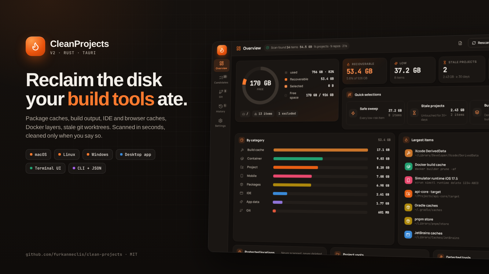
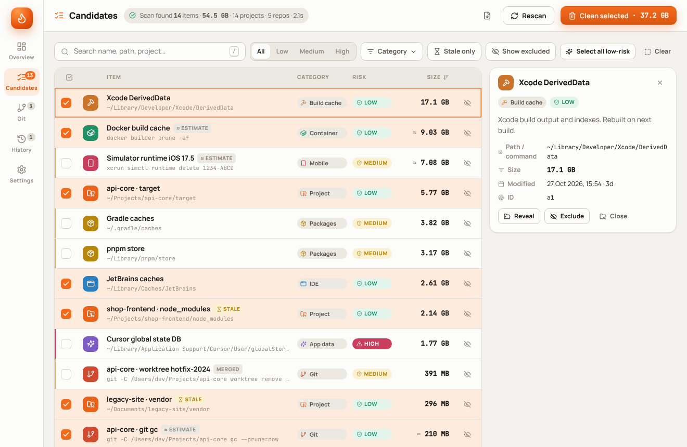
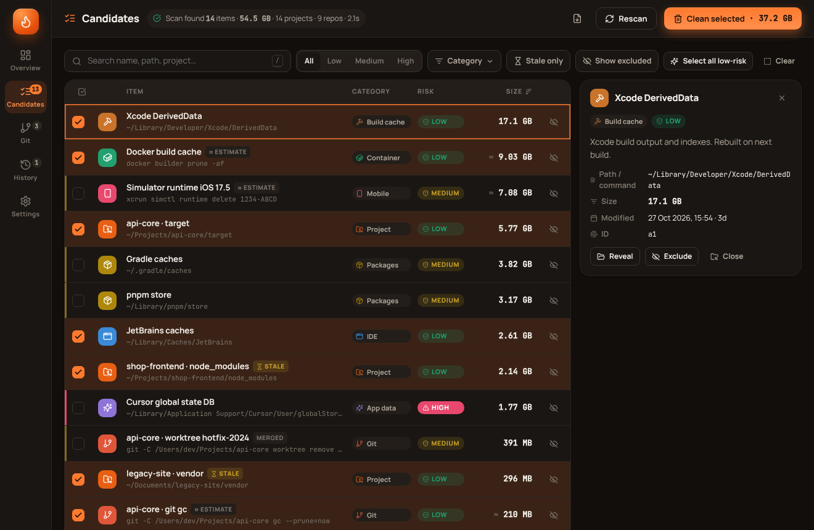
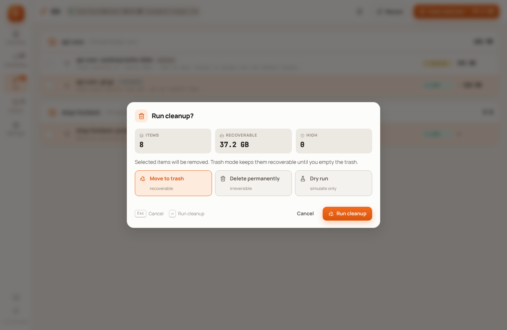
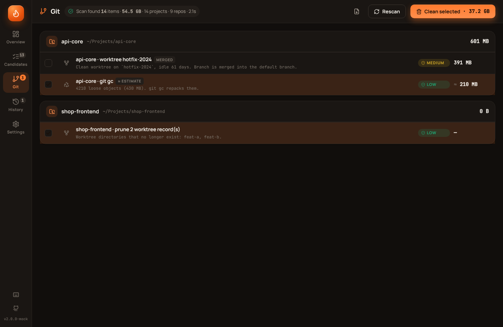
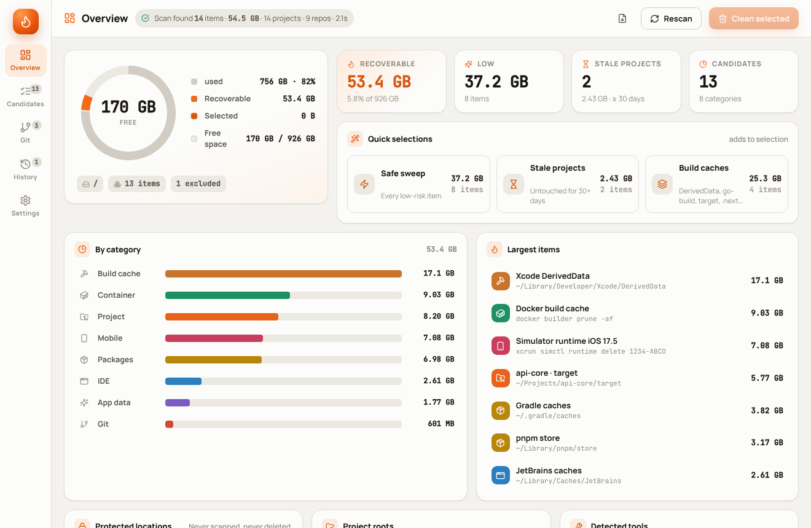
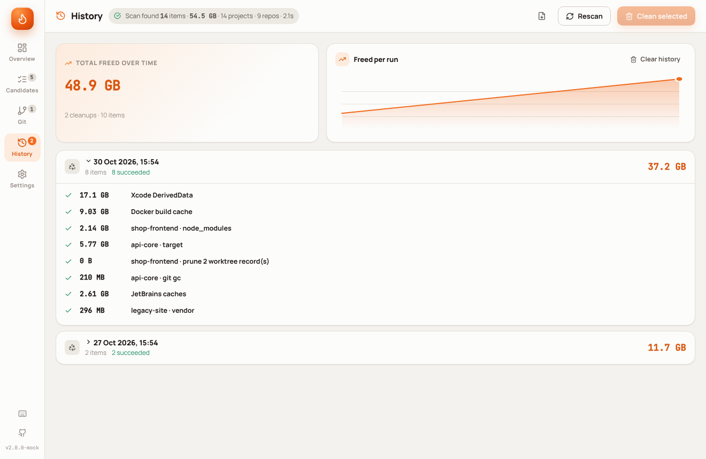

<p align="center">
  
</p>

<p align="center">
  <a href="https://github.com/furkanmeclis/clean-projects/releases"></a>
  <a href="https://github.com/furkanmeclis/clean-projects/actions/workflows/ci.yml"></a>
  
  
  
  <a href="LICENSE"></a>
</p>

# CleanProjects

**CleanProjects finds the disk space your developer tools quietly consume and gives it back, only when you say so.**

It scans package manager stores, compiler caches, build output inside your projects, IDE and browser caches, container engines and git repositories, then shows everything as a reviewable list with a size, a risk level and an explanation. Nothing is deleted until you select it and confirm.

Version 2 is a complete rewrite in Rust. One engine, three front ends:

| Front end | What it is | Best for |
|-----------|------------|----------|
| **Desktop app** | Tauri 2 window with a React dashboard (light and dark) | Everyday use, visual review |
| **Terminal UI** | `cleanprojects` in any terminal, keyboard driven | SSH sessions, servers, terminal people |
| **CLI** | `cleanprojects scan --json`, `cleanprojects clean --dry-run` | Scripts, cron, CI runners |

<p align="center">
  
  
</p>

## What it finds

| Category | Examples |
|----------|----------|
| **Project artifacts** | `node_modules`, `.next`, `.nuxt`, `.turbo`, `dist`, `build`, `target`, `.venv`, `vendor`, `Pods`, `.build`, `bin`/`obj`, `_build`, Unity `Library` |
| **Package stores** | npm, Yarn, pnpm, Bun, Cargo registry, Go modules, pip, uv, Poetry, conda, Gradle, Maven, CocoaPods, pub, Composer, NuGet, Homebrew, Hugging Face |
| **Build caches** | Xcode DerivedData, go-build, sccache, ccache, Bazel, Turbo, Nx, Vite |
| **IDE & editors** | JetBrains, VS Code, Cursor, Windsurf, Zed, Android Studio, Claude Desktop |
| **Browsers** | Chrome, Chromium, Brave, Arc, Firefox, Edge, Safari caches |
| **Containers & VMs** | Docker / Podman build cache and unused images, Vagrant boxes, Minikube, Colima, Lima |
| **Mobile** | iOS DeviceSupport, simulator runtimes and devices, Android AVDs and SDK |
| **Git** | prunable worktree records, idle clean worktrees, merged local branches, repositories that need `git gc` |
| **Temp** | trash bins, logs, crash dumps, Gradle daemon logs |

Project artifacts are only reported when the directory is recognised as a project (`package.json`, `Cargo.toml`, `go.mod`, `pyproject.toml`, `composer.json`, Gradle, Maven, Xcode, `.csproj`, `pubspec.yaml`, `Gemfile`, `mix.exs`, `CMakeLists.txt`, Unity). A folder called `build` next to source files is left alone. Projects that have not been touched for 30 days (configurable) are tagged **stale** so you can sweep them first.

## Safety model

- **Protected locations are never scanned or deleted**: iCloud Drive, `Library/CloudStorage`, Dropbox, Google Drive, OneDrive, `.ssh`, `.gnupg`, `.aws`, `.kube` and anything you add.
- **Every path is re-validated right before deletion**: absolute, not a filesystem root, not your home directory, not inside a protected location, not inside `.git`, not a symlink.
- **Trash mode is the default.** Items go to the OS trash and can be restored until you empty it. Permanent deletion is a separate, explicit choice.
- **Risk levels** explain the cost of removal. *Low*: regenerated automatically. *Medium*: regenerated, but slowly (package stores, device symbols). *High*: may reset an application; close it first.
- **Git operations are conservative.** Worktrees are only offered when their working tree is clean and idle. Branches are deleted with `git branch -d`, so git itself refuses anything unmerged. Merged-branch deletion is off by default.
- **Dry run** shows exactly what would happen, in the app and on the CLI.

<p align="center">
  
  
</p>

## Install

Download from the [Releases](https://github.com/furkanmeclis/clean-projects/releases) page.

**Desktop app**

| Platform | File |
|----------|------|
| macOS (Apple Silicon / Intel) | `CleanProjects_<version>_aarch64.dmg` / `CleanProjects_<version>_x64.dmg` |
| Linux | `.AppImage`, `.deb`, `.rpm` |
| Windows | `CleanProjects_<version>_x64-setup.exe` or `.msi` |

**Terminal (TUI + CLI)**

```bash
# macOS Apple Silicon
curl -L https://github.com/furkanmeclis/clean-projects/releases/latest/download/cleanprojects-aarch64-apple-darwin.tar.gz | tar xz
sudo mv cleanprojects-aarch64-apple-darwin/cleanprojects /usr/local/bin/
```

Other targets: `x86_64-apple-darwin`, `x86_64-unknown-linux-gnu`, `aarch64-unknown-linux-gnu`, `x86_64-pc-windows-msvc.zip`. Every archive has a `.sha256` next to it and `SHA256SUMS.txt` lists them all.

From source:

```bash
cargo install --git https://github.com/furkanmeclis/clean-projects cleanprojects
```

### Installing on macOS without a signed build

Release builds are signed and notarized only when the repository has Apple signing secrets configured. Until then, macOS Gatekeeper will say the app "is damaged" or "cannot be opened". Clear the quarantine flag once:

```bash
xattr -dr com.apple.quarantine /Applications/CleanProjects.app
```

For the terminal binary:

```bash
xattr -d com.apple.quarantine /usr/local/bin/cleanprojects
```

Maintainers: to produce signed builds, add `APPLE_CERTIFICATE` (base64 `.p12`), `APPLE_CERTIFICATE_PASSWORD`, `KEYCHAIN_PASSWORD`, `APPLE_SIGNING_IDENTITY`, `APPLE_ID`, `APPLE_PASSWORD` (app-specific password) and `APPLE_TEAM_ID` as repository secrets. The release workflow imports the certificate and lets Tauri sign and notarize the `.dmg`.

## Using the desktop app

<p align="center">
  
  
</p>

1. The app scans on launch and streams results as they are found.
2. **Overview** shows the disk ring, recoverable space by category, the largest items and quick selections (*Safe sweep*, *Stale projects*, *Build caches*).
3. **Candidates** is the working list: search, filter by risk or category, sort, select, open the detail panel, reveal in Finder/Explorer, or exclude an item from future scans.
4. **Git** groups worktree, branch and gc maintenance per repository.
5. **Clean selected** opens the confirmation with the item count, total size, high-risk warning and the mode (trash, permanent, dry run). Progress and a log stream live.
6. **History** keeps every run with per-item results and a freed-space trend.
7. **Settings** controls trash mode, language (English / Turkish), scan roots, depth, thresholds, protected paths, disabled rules and git options.

Keyboard: `1`–`5` switch views, `⌘/Ctrl R` rescans, `/` focuses search, `?` lists shortcuts.

## Using the terminal UI

```bash
cleanprojects            # opens the TUI and starts scanning
```

| Key | Action |
|-----|--------|
| `Tab` / `1`–`5` | switch view |
| `j` `k` `↑` `↓` `g` `G` | move |
| `space` | select / unselect |
| `a` / `A` | select all low-risk / clear selection |
| `x` | exclude or restore |
| `/` | search, `Esc` clears filters |
| `f` `c` `v` `s` | cycle risk, category, view, sort |
| `i` | detail panel |
| `t` | toggle trash / permanent |
| `d` / `Enter` | clean selected (asks for confirmation, `d` inside toggles dry run) |
| `E` | export a Markdown report to your home directory |
| `r` | rescan |
| `L` | switch language |
| `?` | help |

## Using the CLI

```bash
cleanprojects scan                              # table of candidates (low + medium risk)
cleanprojects scan --json > scan.json           # machine readable
cleanprojects scan --category git --max-risk low
cleanprojects scan --stale --report report.md   # artifacts of idle projects, Markdown report

cleanprojects clean --dry-run                   # show what would be removed
cleanprojects clean --category build-cache --max-risk low --yes
cleanprojects clean --id 4f1c2a9e0b7d3c11 --permanent --yes
cleanprojects clean --stale --yes --json

cleanprojects exclude ~/Projects/keep-me/node_modules
cleanprojects include --all
cleanprojects history
cleanprojects config --set clean.use_trash=false --set scan.roots="~/code,~/work"
cleanprojects doctor
cleanprojects completions zsh > ~/.zfunc/_cleanprojects
```

Global flags: `--lang en|tr`, `--config-dir DIR`, `--no-color`. Scan flags: `--root DIR` (repeatable), `--only-roots`, `--no-git`, `--no-global`, `--no-projects`, `--no-tools`, `--min-size MB`. Filters: `--category`, `--max-risk`, `--stale`, `--query`, `--include-excluded`, `--id`.

`clean` refuses to run without `--yes` when stdin is not a terminal, so a forgotten flag in a cron job cannot delete anything.

## Configuration

`cleanprojects config --path` prints the location (`~/.config/cleanprojects/config.toml` on Linux, `~/Library/Application Support/cleanprojects/config.toml` on macOS, `%APPDATA%\cleanprojects\config.toml` on Windows). The desktop app and the terminal share it.

```toml
[scan]
roots = ["~/code", "/Volumes/Work"]   # extra project roots
default_roots = true                   # also Documents, Projects, dev, code, src, work, repos, ...
max_depth = 6
min_size_mb = 1
stale_days = 30
protected = ["~/Important"]
disabled_rules = ["Ollama"]            # label substring of a global rule

[git]
enabled = true
merged_branches = false
gc = true
worktree_idle_days = 7

[clean]
use_trash = true

[ui]
language = "en"
```

## Build from source

Requirements: Rust 1.80+, Node 22+ (desktop app only). On Linux the desktop app also needs `libwebkit2gtk-4.1-dev libgtk-3-dev libayatana-appindicator3-dev librsvg2-dev`.

```bash
cargo build --release -p cleanprojects          # terminal binary → target/release/cleanprojects
cargo test                                       # engine + CLI tests

cd apps/desktop && npm ci && npm run tauri dev   # desktop app in dev mode
cd apps/desktop && npm run tauri build           # installers under apps/desktop/src-tauri/target/release/bundle
```

Without Tauri, `npm run dev` serves the dashboard in a browser with sample data, which is handy for UI work.

## Repository layout

```
crates/core      engine: candidate model, platform rules, project walker, git analysis, cleaner, config
crates/cli       `cleanprojects` binary: clap CLI + ratatui TUI
apps/desktop     Tauri 2 app (src-tauri) + React/Vite dashboard (src)
legacy/v1        the original Go + React macOS app
.github          CI (fmt, clippy, tests on macOS/Linux/Windows) and release workflows
```

## Release

```bash
git tag v2.0.0
git push origin v2.0.0
```

The release workflow builds terminal binaries for five targets and desktop bundles for macOS (both architectures), Linux and Windows, attaches checksums, and publishes the GitHub release.

## Author

Built by [Furkan Meclis](https://github.com/furkanmeclis).

## License

MIT
